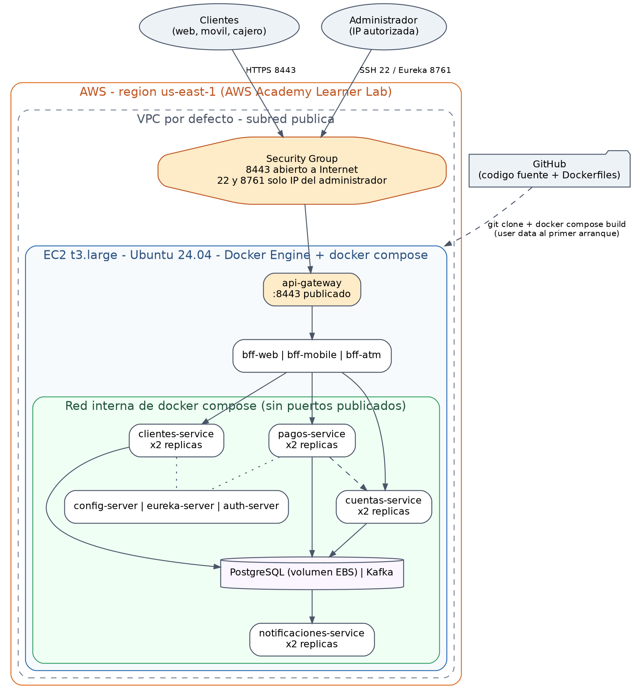

# Pasos para desplegar el sistema en la nube (AWS)

Banco XYZ · Evaluación Final Transversal · PBY2203 Desarrollo Backend III

Este documento explica cómo desplegar el sistema completo en Amazon Web Services, usando **AWS Academy Learner Lab**. El despliegue usa exactamente los mismos contenedores Docker y el mismo `docker-compose.yaml` que se usan en un computador personal: lo único que cambia es dónde corre.

- [1. Arquitectura del despliegue](#1-arquitectura-del-despliegue)
- [2. Herramientas y requisitos](#2-herramientas-y-requisitos)
- [3. Despliegue automatizado](#3-despliegue-automatizado)
- [4. Despliegue manual desde la consola](#4-despliegue-manual-desde-la-consola)
- [5. Verificar el despliegue](#5-verificar-el-despliegue)
- [6. Escalar horizontalmente en la nube](#6-escalar-horizontalmente-en-la-nube)
- [7. Operación y monitoreo](#7-operación-y-monitoreo)
- [8. Actualizar el sistema](#8-actualizar-el-sistema)
- [9. Eliminar los recursos](#9-eliminar-los-recursos)
- [10. Evolución hacia un entorno productivo](#10-evolución-hacia-un-entorno-productivo)
- [11. Problemas frecuentes](#11-problemas-frecuentes)

---

## 1. Arquitectura del despliegue



| Elemento | Configuración | Motivo |
|---|---|---|
| **Región** | `us-east-1` | La que habilita el Learner Lab |
| **Instancia EC2** | `t3.large` (2 vCPU, 8 GB), Ubuntu Server 24.04 LTS, disco gp3 de 30 GB | El sistema levanta hasta 15 procesos Java más Kafka y PostgreSQL; cada uno tiene un límite de memoria definido en `docker-compose.yaml` para caber en 8 GB |
| **Security Group** | `8443` abierto a Internet; `22` y `8761` solo desde la IP del administrador | El único punto de entrada público es el `api-gateway` |
| **Red interna de Docker** | Los microservicios, PostgreSQL y Kafka no publican puertos | No son alcanzables desde Internet ni aunque se abriera el Security Group |
| **Arranque automático** | Script *user data* (`infra/aws/user-data.sh`) | La instancia se configura sola: instala Docker, clona el repositorio, construye las imágenes y levanta el sistema |
| **Persistencia** | Volumen Docker sobre el disco EBS de la instancia | Los datos de PostgreSQL sobreviven a un reinicio de los contenedores o de la instancia |
| **Recuperación** | `restart: unless-stopped` en cada servicio | Si un contenedor cae, Docker lo vuelve a levantar; al reiniciar la instancia, el sistema vuelve solo |

## 2. Herramientas y requisitos

| Herramienta | Uso |
|---|---|
| **AWS Academy Learner Lab** | Cuenta de AWS con credenciales temporales y presupuesto asignado |
| **AWS CloudShell** | Terminal dentro de la consola de AWS, con la AWS CLI ya configurada |
| **Amazon EC2** | La máquina virtual que aloja el sistema |
| **Docker Engine y Docker Compose** | Construyen y orquestan los contenedores; el script de arranque los instala |
| **GitHub** | Origen del código: la instancia clona el repositorio, que debe ser **público** |
| **Cliente SSH** | Administrar la instancia: Git Bash en Windows, o la terminal en macOS y Linux |

Recursos que el Learner Lab ya entrega y que este despliegue reutiliza: el par de claves **`vockey`** y el perfil de instancia **`LabInstanceProfile`**. El laboratorio no permite crear roles de IAM propios, por lo que no se crea ninguno.

Antes de empezar:

1. Entrar al curso de AWS Academy, abrir **Learner Lab** y presionar **Start Lab**. Esperar a que el indicador junto a *AWS* quede en verde.
2. En **AWS Details**, descargar la clave privada con **Download PEM** (archivo `labsuser.pem`).
3. Presionar **AWS** para abrir la consola.
4. Averiguar la IP pública del computador propio abriendo <https://checkip.amazonaws.com> en el navegador.

## 3. Despliegue automatizado

Es el camino recomendado: un script crea el Security Group y la instancia, y la instancia hace el resto.

**Paso 1.** En la consola de AWS, abrir **CloudShell** (ícono de terminal en la barra superior).

**Paso 2.** Clonar el repositorio y ejecutar el script, indicando la URL del repositorio y la IP pública propia:

```bash
git clone https://github.com/Blazeman1/PBY2203_EFT_Fernando_Fuentes_Allende.git
cd PBY2203_EFT_Fernando_Fuentes_Allende

bash infra/aws/desplegar-ec2.sh \
  https://github.com/Blazeman1/PBY2203_EFT_Fernando_Fuentes_Allende.git \
  <MI_IP_PUBLICA>
```

El script realiza estos pasos y muestra cada identificador que crea:

| Paso | Acción |
|---|---|
| 1 | Localiza la VPC por defecto de la región |
| 2 | Crea el Security Group `banco-xyz-eft-sg` con las tres reglas de entrada |
| 3 | Resuelve la imagen oficial más reciente de Ubuntu Server 24.04 |
| 4 | Lanza la instancia `t3.large` con el script de arranque, y espera a que esté en ejecución |

Al terminar imprime el identificador de la instancia, su **IP pública** y los comandos para seguir el avance y para eliminar todo.

**Paso 3.** La instancia tarda entre 15 y 20 minutos en dejar el sistema arriba, porque la primera vez construye las 12 imágenes. Para seguir el avance, desde el computador propio:

```bash
chmod 400 labsuser.pem
ssh -i labsuser.pem ubuntu@<IP_PUBLICA> 'tail -f /var/log/banco-xyz-arranque.log'
```

Cuando la bitácora muestre `ARRANQUE COMPLETADO`, el sistema está desplegado. Continuar en la sección 5.

### Qué hace el script de arranque

`infra/aws/user-data.sh` se ejecuta una sola vez, en el primer arranque de la instancia:

1. Crea 4 GB de memoria de intercambio, que absorben el pico de memoria de la construcción y del arranque simultáneo.
2. Instala Docker Engine con los plugins `compose` y `buildx`, además de `git`, `curl` y `jq`.
3. Configura la rotación de los logs de los contenedores, para que no llenen el disco.
4. Clona el repositorio en `/opt/banco-xyz`.
5. Construye las imágenes y levanta el sistema con `docker compose`.

## 4. Despliegue manual desde la consola

Alternativa al script, con el mismo resultado.

**4.1 Security Group.** En **EC2 → Security Groups → Create security group**:

| Tipo | Puerto | Origen | Para qué |
|---|---|---|---|
| Custom TCP | 8443 | `0.0.0.0/0` | api-gateway |
| SSH | 22 | *My IP* | Administración |
| Custom TCP | 8761 | *My IP* | Panel de Eureka |

**4.2 Instancia.** En **EC2 → Instances → Launch instances**:

| Campo | Valor |
|---|---|
| Name | `banco-xyz-eft` |
| AMI | Ubuntu Server 24.04 LTS (64-bit x86) |
| Instance type | `t3.large` |
| Key pair | `vockey` |
| Security group | El creado en el paso 4.1 |
| Storage | 30 GiB, gp3 |
| Advanced details → IAM instance profile | `LabInstanceProfile` |
| Advanced details → User data | El contenido de `infra/aws/user-data.sh`, reemplazando `__REPO_URL__` por la URL del repositorio |

**4.3** Presionar **Launch instance**, copiar la IP pública cuando la instancia esté *Running* y seguir el avance como en el paso 3 de la sección anterior.

**Si el repositorio fuera privado**, la instancia no podría clonarlo. En ese caso, dejar el *user data* vacío, copiar el proyecto con `scp -i labsuser.pem -r . ubuntu@<IP_PUBLICA>:/home/ubuntu/banco-xyz`, y ejecutar a mano los comandos de `infra/aws/user-data.sh`.

## 5. Verificar el despliegue

### 5.1 Desde el computador propio, a través de Internet

Con la IP pública de la instancia:

```bash
IP=<IP_PUBLICA>

# Iniciar sesión en el canal web, entrando por el gateway
TOKEN=$(curl -sk -X POST https://$IP:8443/api/web/auth/login \
  -H "Content-Type: application/json" -d '{"cuentaId":101,"nombre":"John Doe"}' | jq -r .token)

# Consultar la cuenta
curl -sk -H "Authorization: Bearer $TOKEN" https://$IP:8443/api/web/cuentas/101 | jq 'del(.movimientos)'

# Canal móvil
TOKEN_M=$(curl -sk -X POST https://$IP:8443/api/mobile/auth/login \
  -H "Content-Type: application/json" -d '{"cuentaId":101,"pin":"7373"}' | jq -r .token)
curl -sk -H "Authorization: Bearer $TOKEN_M" https://$IP:8443/api/mobile/cuentas/101/resumen | jq .
```

El panel de Eureka queda disponible en `http://<IP_PUBLICA>:8761`, solo desde la IP autorizada.

Comprobar que lo demás **no** es alcanzable desde Internet:

```bash
curl -sk --max-time 5 https://$IP:8081/actuator/health || echo "bff-web: no alcanzable (correcto)"
curl -s  --max-time 5 http://$IP:9000/actuator/health  || echo "auth-server: no alcanzable (correcto)"
```

### 5.2 Dentro de la instancia: corrida completa de pruebas

```bash
ssh -i labsuser.pem ubuntu@<IP_PUBLICA>
cd /opt/banco-xyz

docker compose -f docker-compose.yaml ps          # todos los servicios deben estar (healthy)

# Ejecuta las pruebas de las tres partes, la escalabilidad y la tolerancia a fallos,
# reutilizando las imágenes ya construidas y dejando el sistema arriba al terminar
bash scripts/generar_evidencia.sh --skip-build --mantener
```

Los resultados quedan en `/opt/banco-xyz/evidencias/`. Para traerlos al computador propio:

```bash
scp -i labsuser.pem "ubuntu@<IP_PUBLICA>:/opt/banco-xyz/evidencias/evidencia*.log" ./evidencias-aws/
```

## 6. Escalar horizontalmente en la nube

Dentro de la instancia, agregar réplicas de los tres microservicios con el sistema en marcha:

```bash
cd /opt/banco-xyz
docker compose -f docker-compose.yaml up -d --no-recreate \
  --scale clientes-service=2 --scale cuentas-service=2 --scale pagos-service=2
```

O ejecutar la prueba que además genera carga y muestra el reparto:

```bash
bash scripts/probar_escalabilidad.sh 2
```

Qué se observa:

| Evidencia | Dónde |
|---|---|
| Dos instancias de cada microservicio registradas | Panel de Eureka: `http://<IP_PUBLICA>:8761` |
| Dos contenedores por servicio, ambos *healthy* | `docker compose -f docker-compose.yaml ps` |
| Peticiones repartidas entre las réplicas | `docker compose -f docker-compose.yaml logs cuentas-service \| grep PETICION` |
| Particiones de Kafka repartidas entre las réplicas | Salida del script, sección 6 |

Por qué el sistema escala sin cambios de código:

- **Los microservicios no guardan estado en memoria.** Su estado vive en PostgreSQL, y los saldos se modifican con bloqueo de fila.
- **Las réplicas se registran solas en Eureka**, y los clientes reparten las peticiones entre las instancias registradas.
- **Las réplicas comparten el *consumer group* de Kafka**, que reparte entre ellas las 4 particiones de cada tópico.
- **Las operaciones de dinero son idempotentes**, de modo que un evento entregado dos veces no mueve dinero dos veces.

En una `t3.large`, dos réplicas por microservicio es el máximo razonable. Para más réplicas, usar una instancia mayor (`TIPO_INSTANCIA=t3.xlarge bash infra/aws/desplegar-ec2.sh ...`) o pasar al esquema de la sección 10.

## 7. Operación y monitoreo

| Tarea | Comando (dentro de la instancia, en `/opt/banco-xyz`) |
|---|---|
| Estado y salud de cada servicio | `docker compose -f docker-compose.yaml ps` |
| Logs de un servicio, en vivo | `docker compose -f docker-compose.yaml logs -f pagos-service` |
| Registro de operaciones de un microservicio | `docker compose -f docker-compose.yaml logs cuentas-service \| grep PETICION` |
| Alertas de seguridad procesadas | `docker compose -f docker-compose.yaml logs notificaciones-service \| grep ALERTA` |
| Uso de CPU y memoria por contenedor | `docker stats --no-stream` |
| Memoria y disco de la instancia | `free -h` · `df -h /` |
| Reiniciar un servicio | `docker compose -f docker-compose.yaml restart bff-web` |
| Ejecutar los procesos batch | `docker compose -f docker-compose.yaml --profile batch run --rm batch todos` |

Las métricas de CPU, red y disco de la instancia están en **EC2 → Instances → Monitoring** (Amazon CloudWatch).

## 8. Actualizar el sistema

Después de subir cambios al repositorio:

```bash
ssh -i labsuser.pem ubuntu@<IP_PUBLICA>
cd /opt/banco-xyz
git pull
docker compose -f docker-compose.yaml up -d --build     # reconstruye y reemplaza solo lo que cambió
```

Los datos se conservan. Si cambió el esquema de la base de datos, ejecutar antes `docker compose -f docker-compose.yaml down -v`, que borra los datos y hace que el esquema se cree de nuevo.

## 9. Eliminar los recursos

El Learner Lab descuenta presupuesto mientras la instancia exista. Al terminar, desde CloudShell:

```bash
aws ec2 terminate-instances --instance-ids <ID_DE_INSTANCIA>
aws ec2 wait instance-terminated --instance-ids <ID_DE_INSTANCIA>
aws ec2 delete-security-group --group-name banco-xyz-eft-sg
```

O desde la consola: **EC2 → Instances → Instance state → Terminate**, y luego eliminar el Security Group.

Detener la sesión con **End Lab** apaga la instancia pero no la elimina: su IP pública cambia al volver a iniciarla. El sistema se levanta solo, sin pasos adicionales.

## 10. Evolución hacia un entorno productivo

Este despliegue corre todo en una sola instancia, lo que es adecuado para el laboratorio pero deja a la instancia como punto único de falla. Como cada componente ya es una imagen Docker independiente y sin estado local, el paso a un entorno productivo cambia la plataforma, no el código:

| Hoy (laboratorio) | En producción | Qué se gana |
|---|---|---|
| Contenedores en una instancia EC2 | **Amazon ECS con Fargate** (o EKS), en varias zonas de disponibilidad | Sin punto único de falla; escalado automático según la carga |
| Imágenes construidas en la instancia | **Amazon ECR**, publicadas por el pipeline de integración continua | Despliegues reproducibles y más rápidos |
| PostgreSQL en un contenedor | **Amazon RDS for PostgreSQL** Multi-AZ, una instancia por servicio | Respaldos automáticos y conmutación ante fallas |
| Kafka en un contenedor | **Amazon MSK** | Varios brokers, con los datos replicados |
| api-gateway con certificado autofirmado | **Application Load Balancer** con un certificado de **AWS Certificate Manager** | HTTPS válido para los clientes |
| Secretos en archivos de configuración | **AWS Secrets Manager** | Secretos fuera del repositorio, con rotación |
| Logs de `docker compose` | **Amazon CloudWatch Logs** y alarmas | Búsqueda centralizada y avisos automáticos |
| Eureka y Config Server propios | Se mantienen, o se reemplazan por ECS Service Connect y AWS AppConfig | Menos componentes que administrar |

## 11. Problemas frecuentes

| Síntoma | Causa y solución |
|---|---|
| El script falla con `UnauthorizedOperation` | La sesión del laboratorio expiró. Volver a presionar **Start Lab** y abrir CloudShell de nuevo |
| `InvalidKeyPair.NotFound` | El par de claves `vockey` existe solo en `us-east-1`. Verificar la región |
| No se puede entrar por SSH | La IP pública propia cambió. Actualizar la regla del puerto 22 en el Security Group |
| `Permission denied (publickey)` | Falta `chmod 400 labsuser.pem`, o el usuario no es `ubuntu` |
| El gateway no responde a los pocos minutos de crear la instancia | La construcción aún no termina. Revisar `/var/log/banco-xyz-arranque.log` |
| La bitácora muestra un error en `git clone` | El repositorio no es público, o la URL es incorrecta |
| Un contenedor se reinicia una y otra vez | Memoria insuficiente. Verificar con `free -h` que la instancia sea `t3.large` y que la memoria de intercambio esté activa |
| Después de **End Lab** y **Start Lab** la IP no responde | La IP pública cambió. Consultar la nueva en **EC2 → Instances** |
