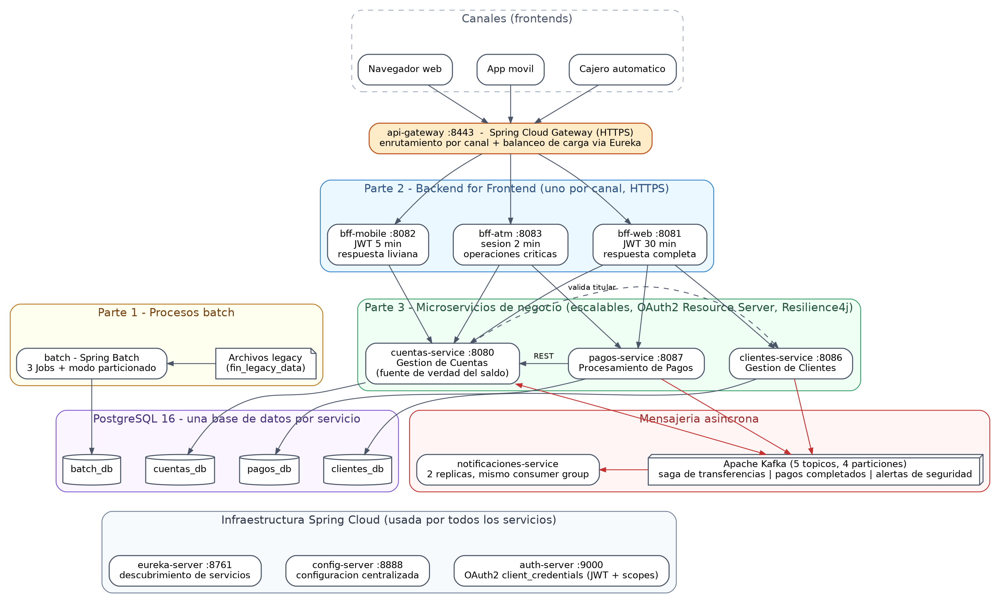
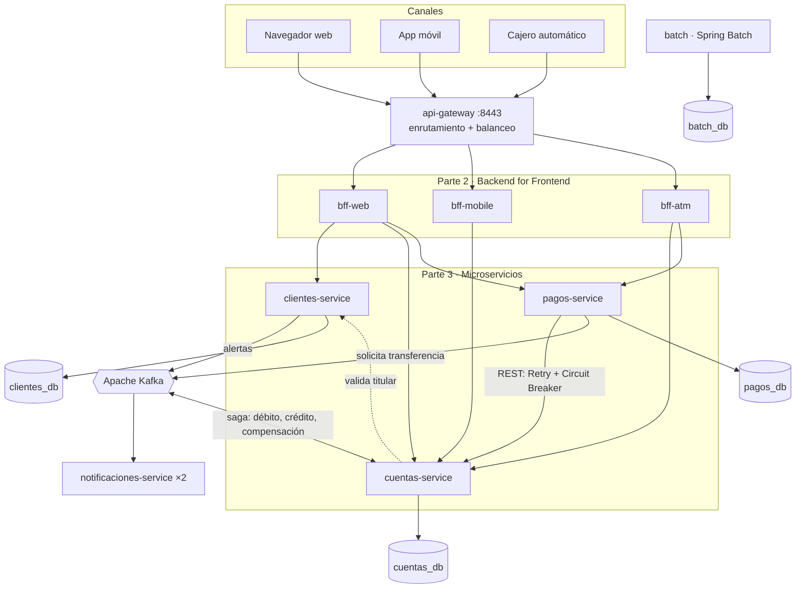

# Banco XYZ — Modernización del sistema legacy

**Evaluación Final Transversal · PBY2203 Desarrollo Backend III · Duoc UC**
**Autor:** Fernando Fuentes Allende

**Código fuente (GitHub):** <https://github.com/Blazeman1/PBY2203_EFT_Fernando_Fuentes_Allende>

Este repositorio contiene la solución completa del caso: la migración del sistema bancario legacy del Banco XYZ (COBOL y scripts Shell sobre mainframe) a una arquitectura de microservicios lista para la nube. Reúne las tres partes del encargo en un solo proyecto que se construye y se levanta con un único comando.

| Documento | Contenido |
|---|---|
| **readme.md** (este archivo) | Enlace al código, visión general, arquitectura y mapa del repositorio |
| [instrucciones.md](instrucciones.md) | Cómo ejecutar y probar cada componente, paso a paso |
| [despliegue.md](despliegue.md) | Cómo desplegar el sistema en AWS |
| `Informe_tecnico_EFT.pdf` | Informe técnico (se entrega junto al video, fuera del repositorio) |

---

## 1. Qué resuelve cada parte

| Parte del caso | Problema del legacy | Solución implementada | Módulos |
|---|---|---|---|
| **1. Procesos batch** | Tres procesos nocturnos en COBOL/Shell, sin tolerancia a datos erróneos ni forma de reanudar tras una falla | Tres Jobs de **Spring Batch** (transacciones diarias, intereses, estados de cuenta anuales) con políticas de omisión y reintento, procesamiento paralelo (multi-hilo y particionado), control de calidad y reejecución automática | `batch` |
| **2. Backend for Frontend** | Web, móvil y cajeros conectados al mismo backend, recibiendo todos los mismos datos | Un **BFF por canal**, cada uno con su propia autenticación, su propio formato de respuesta y su propio certificado HTTPS | `bff-web`, `bff-mobile`, `bff-atm` |
| **3. Microservicios resilientes** | Monolito difícil de escalar, donde una falla afecta a todo y la seguridad es única y central | Tres **microservicios** con base de datos propia (clientes, cuentas, pagos), **Spring Cloud** (Config, Eureka, Gateway), **OAuth2**, **Resilience4j**, **Kafka** y **Docker** | `clientes-service`, `cuentas-service`, `pagos-service`, `notificaciones-service`, `auth-server`, `config-server`, `eureka-server`, `api-gateway` |

## 2. Arquitectura





Todos los servicios obtienen su configuración de **config-server**, se registran en **eureka-server** y se autentican entre sí con tokens OAuth2 emitidos por **auth-server**. Estos tres componentes de infraestructura no aparecen en el diagrama anterior para mantenerlo legible; sí aparecen en la imagen.

### Los cinco procesos clave de la migración

| # | Proceso clave | Dónde se materializa |
|---|---|---|
| 1 | **Migración de procesos batch a Spring Batch** | Módulo `batch`: tres Jobs equivalentes a los procesos legacy, sobre el dataset oficial `fin_legacy_data` |
| 2 | **División del monolito en microservicios** | `clientes-service`, `cuentas-service` y `pagos-service`, cada uno con su base de datos PostgreSQL y su ciclo de despliegue |
| 3 | **Implementación del patrón BFF** | `bff-web`, `bff-mobile` y `bff-atm`, detrás del `api-gateway` |
| 4 | **Seguridad distribuida con Spring Security y OAuth2** | `auth-server` (Spring Authorization Server) emite JWT con un scope por microservicio; cada microservicio es un Resource Server que exige el suyo |
| 5 | **Mensajería asíncrona con Apache Kafka** | Saga de transferencias entre `pagos-service` y `cuentas-service`, eventos de pagos completados y alertas de seguridad consumidos por `notificaciones-service` |

## 3. Mapa del repositorio

```
├── readme.md · instrucciones.md · despliegue.md      Documentación de la entrega
├── docker-compose.yaml                               Orquestación completa (13 servicios + batch)
├── docker-compose.infra.yml                          Solo PostgreSQL y Kafka, para desarrollar desde el IDE
├── pom.xml                                           Agregador Maven (no es parent de ningún módulo)
│
├── batch/                     PARTE 1  Spring Batch: 3 Jobs + modo particionado
├── bff-web/                   PARTE 2  Canal web: respuesta completa, JWT de 30 minutos
├── bff-mobile/                PARTE 2  Canal móvil: respuesta liviana, JWT de 5 minutos
├── bff-atm/                   PARTE 2  Canal cajero: saldo, retiro y depósito; sesión de 2 minutos
├── clientes-service/          PARTE 3  Gestión de Clientes
├── cuentas-service/           PARTE 3  Gestión de Cuentas (fuente de verdad del saldo)
├── pagos-service/             PARTE 3  Procesamiento de Pagos (transferencias, depósitos, pagos)
├── notificaciones-service/    PARTE 3  Consumidor de eventos Kafka
│
├── config-server/             Spring Cloud Config (configuración centralizada en config-repo/)
├── eureka-server/             Descubrimiento de servicios
├── auth-server/               Servidor de autorización OAuth2 (client_credentials, JWT, scopes)
├── api-gateway/               Spring Cloud Gateway: punto de entrada único
│
├── infra/postgres/init/       Esquema SQL: una base de datos por servicio
├── infra/aws/                 Scripts de despliegue en AWS (EC2)
├── scripts/                   Pruebas automatizadas y generación de evidencia
├── evidencias/                Logs de ejecución generados por los scripts
├── docs/diagramas/            Diagramas (fuentes .dot/.mmd e imágenes)
└── .github/workflows/         Integración continua: ejecuta la corrida completa en cada push
```

Cada módulo Java es una aplicación Spring Boot **autónoma**: tiene su propio `pom.xml` (con `spring-boot-starter-parent` como padre directo), su propio `Dockerfile` y no comparte código con los demás. El acoplamiento entre servicios se limita a contratos HTTP/JSON y a eventos Kafka; por eso cada uno puede construirse, versionarse y desplegarse por separado.

## 4. Puesta en marcha rápida

Requisitos: Docker (con `docker compose`), y para las pruebas `curl` y `jq`. No se necesita Java ni Maven instalados: las imágenes se construyen dentro de Docker.

```bash
git clone https://github.com/Blazeman1/PBY2203_EFT_Fernando_Fuentes_Allende.git
cd PBY2203_EFT_Fernando_Fuentes_Allende

# Corrida completa: construye, levanta, prueba las tres partes y guarda la evidencia
bash scripts/generar_evidencia.sh
```

O, paso a paso:

```bash
docker compose -f docker-compose.yaml up -d --build                        # levantar todo
docker compose -f docker-compose.yaml --profile batch run --rm batch todos # Parte 1: procesos batch
bash scripts/probar_apis.sh                                                # Parte 2: los tres canales
bash scripts/probar_microservicios.sh                                      # Parte 3: clientes, cuentas y pagos
bash scripts/probar_transferencias.sh                                      # Parte 3: saga con Kafka
bash scripts/probar_escalabilidad.sh                                       # escalar a 2 réplicas
bash scripts/probar_tolerancia_fallos.sh                                   # Resilience4j en acción
```

El detalle de cada paso, las credenciales de demostración y la forma de probar cada componente por separado están en [instrucciones.md](instrucciones.md).

## 5. Decisiones de arquitectura

| Decisión | Alternativa descartada | Por qué |
|---|---|---|
| **Una base de datos por microservicio** (PostgreSQL) | Base de datos compartida, o datos en memoria | Es la condición para escalar horizontalmente: todas las réplicas de un servicio ven el mismo estado, y ningún servicio depende del esquema de otro |
| **Saga por coreografía con Kafka** para las transferencias | Transacción distribuida (2PC) u orquestador central | No existe una transacción ACID que abarque dos bases de datos. Cada paso es una transacción local idempotente, y un paso fallido se repara con una compensación explícita |
| **REST sincrónico** para depósitos y pagos de servicios | Hacer todo asíncrono | Tocan una sola cuenta y el canal espera la respuesta. Se protege con Retry + Circuit Breaker y una clave de idempotencia que hace seguro reintentar |
| **OAuth2 `client_credentials` con un scope por microservicio** | Clave compartida entre servicios | Mínimo privilegio: el token del canal móvil no sirve para llamar a pagos ni a clientes. Las credenciales de un canal se rotan sin afectar a los demás |
| **Autenticación de usuario propia en cada BFF** | Un único mecanismo de login para todos los canales | Cada canal tiene riesgos distintos: sesión larga en la web, corta en el móvil y de un solo uso en el cajero |
| **Bloqueo de fila en PostgreSQL** para mover saldos | `synchronized` dentro de la JVM | Con varias réplicas, el único punto común donde se puede serializar el acceso a un saldo es la base de datos |
| **Los microservicios no publican puertos** | Publicar cada puerto en el host | Seguridad (solo el gateway y los BFF son alcanzables) y escalabilidad (un puerto fijo solo admite un contenedor) |
| **El esquema lo crea un script SQL** de inicialización | `ddl-auto` de Hibernate | Varias réplicas pueden arrancar a la vez sin competir por crear las mismas tablas |

## 6. Comparación con el sistema legacy

| Aspecto | Sistema legacy | Sistema nuevo |
|---|---|---|
| Procesos batch | Secuenciales; un registro inválido detiene el proceso; ante una falla se repite todo | Paralelos (3 hilos o 4 particiones); los registros inválidos se omiten y se registran; se reanuda desde la metadata y se reejecuta automáticamente |
| Calidad de datos | Sin control: los errores llegan a los reportes | Validación, corrección automática y un control de calidad que impide generar un reporte sobre datos inservibles |
| Canales | Todos reciben la misma respuesta del monolito | Cada canal recibe lo que necesita: la vista móvil pesa una fracción de la vista web |
| Escalabilidad | Vertical: un mainframe más grande | Horizontal: se agregan réplicas en caliente, sin detener el servicio |
| Tolerancia a fallos | Una falla en un módulo afecta a todo el sistema | Fallas aisladas: circuit breaker, reintentos, respuestas degradadas y compensación |
| Seguridad | Central y única | Distribuida: cada servicio valida un token con su propio scope; HTTPS en cada canal |
| Integración | Acoplada, por archivos y llamadas directas | Eventos en Kafka: se agregan consumidores sin modificar a los productores |
| Despliegue | Manual, sobre el mainframe | Contenedores Docker reproducibles; el mismo `docker-compose.yaml` en un computador, en integración continua y en AWS |

## 7. Evidencia de ejecución

`scripts/generar_evidencia.sh` ejecuta la corrida completa y deja en `evidencias/` un archivo por etapa:

| Archivo | Qué demuestra |
|---|---|
| `evidencia01-docker-build.log` | Construcción de las 12 imágenes Docker |
| `evidencia02` · `evidencia03` | Levantamiento del stack y estado *healthy* de cada contenedor |
| `evidencia04-eureka.log` | Servicios registrados en Eureka |
| `evidencia05-parte1-batch.log` | Parte 1: Jobs, paralelismo, omisiones, metadata y resultados |
| `evidencia06-parte2-canales-bff.log` | Parte 2: los tres canales, OAuth2 con mínimo privilegio y el gateway |
| `evidencia07-parte3-microservicios.log` | Parte 3: ciclo de vida completo de clientes, cuentas y pagos |
| `evidencia08-transferencias-saga.log` | Saga: transferencia completada, rechazada y compensada |
| `evidencia09-eventos-kafka.log` | Eventos consumidos, por réplica y partición |
| `evidencia10-escalabilidad-horizontal.log` | Escalado a 2 réplicas y reparto de la carga |
| `evidencia11-tolerancia-fallos.log` | Circuit breaker, reintentos, degradación y recuperación |

El mismo script se ejecuta en GitHub Actions en cada *push* a `main` (pestaña **Actions** del repositorio) y publica estos archivos como artefacto descargable.

## 8. Alcance y simplificaciones

Estas decisiones acotan el trabajo a lo que el caso pide y se declaran para que no se confundan con omisiones:

- **Credenciales de demostración.** Los secretos (claves OAuth2, contraseñas de base de datos y de los almacenes de certificados) están en archivos de configuración y son valores de uso académico. En producción vivirían en un gestor de secretos.
- **Certificados autofirmados.** Los BFF y el gateway usan HTTPS con certificados propios; por eso las pruebas usan `curl -k`.
- **Inicio de sesión simplificado.** El dataset legacy no trae contraseñas: la web valida el número de cuenta y el nombre del titular, y el móvil y el cajero usan un PIN derivado del número de cuenta.
- **Un cliente por cuenta en la migración.** El legacy no distingue cliente de cuenta, así que se crea un cliente por cada cuenta válida. Los clientes creados después pueden tener varias cuentas.
- **La sesión del cajero vive en la memoria de `bff-atm`.** Para escalar ese BFF haría falta un almacén de sesiones compartido.
- **`auth-server` genera su par de claves al arrancar** y corre en una sola instancia.
- **Un solo servidor PostgreSQL y un solo broker Kafka**, con una base de datos lógica por servicio. En producción serían servicios administrados con réplicas.
